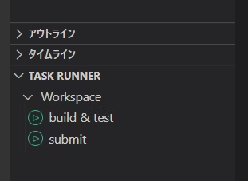

# AtCoder Rust

[cargo-compete](https://github.com/qryxip/cargo-compete)を使用しています
詳しい利用方法は[こちら](https://qiita.com/rokoooouribo/items/76a0057c75694fd943f5)

できること・便利な点・コンテストでの使い方は[使い方ガイド](docs/guide.md)にまとめています

[Click here for the English Readme](https://github.com/uriuriboo/atcoder_rust/blob/main/Readme_en.md)

## この環境でできること

VS Code で Dev Container として開くだけで、AtCoder の提出環境に合わせた Rust の開発環境ができます。普段の操作はタスクランナーから行います。

### 用意されるもの

- AtCoder の 2025年10月の言語環境と同じ Rust 1.89.0（edition 2024）と、同じバージョンのクレート（proconio、ac-library-rs、itertools など）
- cargo-compete（問題の取得・テスト・提出）と cargo-member（コンテストをワークスペースに追加）
- rustfmt、clippy、graphviz（グラフ可視化）、mold（高速なリンカ）
- コンテナ作成時に AtCoder へのログインを試みます。失敗した場合は、後からタスク「login」でログインできます

### タスクランナーでできること

`.rs` ファイルを開いた状態で実行すると、ファイルの場所（`abc325/src/bin/a.rs` など）から解いている問題を自動で判定します。タスクは `Ctrl+Shift+P` →「タスク: タスクの実行」からも実行できます。

| タスク | 内容 |
| --- | --- |
| new contest | コンテスト ID（`abc325` など）を入力すると、問題とサンプルを取得してワークスペースに追加 |
| build | 開いている問題だけをビルド |
| build & test | 開いている問題をビルドして、サンプルでテスト |
| build & test release | リリースビルドでテスト（実行時間の確認用） |
| submit | 開いている問題を提出（提出前に自動でテスト） |
| stress: init / hack / test | ランダムな入力で愚直解と比べ、サンプル以外の反例を探す（[使い方](docs/stress_test.md)） |
| visualize graph | `input.txt` のグラフを画像（`graph.png`）にして表示。有向グラフ用の「visualize graph (directed)」もあります |
| login | AtCoder にログイン |

### 便利にしている点

- **解いている問題だけをビルド**：他の問題が書きかけでコンパイルできなくても、テストできます
- **サンプルテストを並列実行**：CPU のコア数だけ同時に実行します
- **すぐにデバッグできる**：build 系のタスクを実行すると、`launch.json` が解いている問題に書き換わります。`input.txt` に入力を書いて F5 でデバッグ実行できます
- **ビルドが速い**：mold でリンクを速くし、ビルド成果物（`target/`）は Windows でも I/O が速い Docker ボリュームに置いています。ツール類は Docker イメージに含めているので、コンテナの作り直しも速くなります
- **エディタの補助**：保存時に自動フォーマットし、clippy でチェックします（チェックは開いているコンテストだけなので、コンテストが増えても遅くなりません）。スニペット（`tmplt` でテンプレート、`rep` でループなど）も使えます
- **グラフの可視化**：問題の入力を `input.txt` に貼るだけで、木や重み付きグラフを図にできます。1行目が `N` なら木、`N M` なら M 本の辺として自動で判定します
- **ライブラリ**：`library/src/` に、ダイクストラやエラトステネスの篩などのコピペ用コードがあります

### その他

- `scripts/test.bash`：online-judge-tools（`oj`）でテストする手動実行用のスクリプトです。`oj` はコンテナ作成時にインストールされます
- GitHub Actions で、push のたびに環境構築とテストが動くか確認しています
- AtCoder のログイン画面に CAPTCHA が導入されたため、ログインや提出が失敗することがあります。その場合は、ブラウザでログインして Cookie の `REVEL_SESSION` を `~/.local/share/cargo-compete/cookies.jsonl` に書き写すと回避できます

## 使い方

### ビルドとテスト

#### コマンドラインからビルドとテスト

```bash:
./scripts/build_test.bash コンテストの数字 問題のアルファベット
```

#### クリックでビルドとテスト

テストしたい.rsファイルをvscodeで表示した状態で右下のTASKRUNNERのbuild & testをクリック



### 提出

#### コマンドラインから提出

```bash:
./scripts/submit.bash コンテストの数字 問題のアルファベット
```

#### クリックで提出

上の写真で同様に提出したい.rsファイルをvscodeで表示した状態で右下のTASKRUNNERのsubmitをクリックしてもできます

### デバッグ

input.txtにデバッグの入力を入れてください

コマンドラインでビルドとテストを行った場合はlaunch.jsonのprogramを解いている問題のコンテストの数字に書き換えてください

build & testをクリックしたときに書き換わるように設定しました

## 注意

コマンドラインから操作をしたい場合はlaunch.jsonとscripts/build_test.bashとscripts/submit.bashはabc、arc、agcごとに書き換えてください
