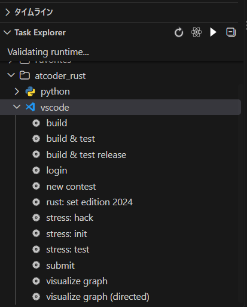

# Docker environment for AtCoder in Rust

We use [cargo-compete](https://github.com/qryxip/cargo-compete)
For detailed usage [here](https://qiita.com/rokoooouribo/items/76a0057c75694fd943f5) (japanese)

See the [user guide](docs/guide_en.md) for what this environment can do, why it is convenient, and how to use it in a contest

## What this environment provides

Open the repository as a Dev Container in VS Code and you get a Rust environment that matches AtCoder's judge. Day-to-day operations are run from the task runner.

### What gets installed

- Rust 1.89.0 (edition 2024) and the same crate versions as AtCoder's October 2025 language environment (proconio, ac-library-rs, itertools, and more)
- cargo-compete (fetch problems, test, submit) and cargo-member (add a contest to the workspace)
- rustfmt, clippy, graphviz (graph visualization), and mold (a fast linker)
- Python 3.15 for the brute-force solutions and input generators of random testing (installed with uv)
- The container tries to log in to AtCoder when it is created. If that fails, log in later with the "login" task

### Tasks

Run a task with a `.rs` file open, and the problem you are solving is detected from the file's location (for example `abc325/src/bin/a.rs`). You can also run tasks from `Ctrl+Shift+P` → "Tasks: Run Task".

| Task | What it does |
| --- | --- |
| new contest | Enter a contest ID (such as `abc325`) to fetch its problems and samples and add it to the workspace |
| build | Build only the open problem |
| build & test | Build the open problem and test it against the samples |
| build & test release | Test with a release build (to check running time) |
| submit | Submit the open problem (samples are tested automatically first) |
| stress: init / hack / test | Compare against a brute-force solution on random inputs to find counterexamples the samples miss ([how to use](docs/stress_test.md), Japanese) |
| visualize graph | Render the graph in `input.txt` as an image (`graph.png`) and open it. "visualize graph (directed)" is for directed graphs |
| login | Log in to AtCoder |

### Conveniences

- **Builds only the problem you are solving**: you can test even if another problem is half-written and does not compile
- **Runs sample tests in parallel**: as many at once as you have CPU cores
- **Ready to debug**: the build tasks point `launch.json` at the current problem. Put the input in `input.txt` and press F5
- **Fast builds**: mold speeds up linking, and build output (`target/`) lives on a Docker volume, which has fast I/O even on Windows. Tools are baked into the Docker image, so rebuilding the container is quick too
- **Editor support**: format on save and clippy checks (only the open contest is checked, so it stays fast as contests pile up). Snippets are available too (`tmplt` for the template, `rep` for a loop, and so on). The Python you write for random testing gets completion (Pylance) and Ruff checks and formatting too
- **Graph visualization**: paste a problem's input into `input.txt` to draw trees and weighted graphs. A first line of `N` is read as a tree, and `N M` as M edges
- **Library**: `library/src/` has copy-and-paste code such as Dijkstra and the sieve of Eratosthenes

### Other

- `scripts/test.bash`: a script you run by hand to test with online-judge-tools (`oj`). `oj` is installed when the container is created
- GitHub Actions checks on every push that the environment builds and tests run
- AtCoder added a CAPTCHA to its login page, so logging in or submitting may fail. To work around it, log in with a browser and copy the `REVEL_SESSION` cookie into `~/.local/share/cargo-compete/cookies.jsonl`

## How to use

### Build and test

#### Build and test from command line

```bash:
./scripts/build_test.bash (Contest Number) (Alphabet in question)
```

#### Click to build and test

With the .rs file you want to test open in vscode, click build & test in Task Explorer in the Explorer



### Submit

#### Submit from  command line

```bash:
./scripts/submit.bash (Contest Number) (Alphabet in question)
```

#### Click to submit

You can also click submit in Task Explorer (see the picture above) with the .rs file you want to submit open in vscode.

### Debugging

Put your debugging input in input.txt

If you did the build & test on the command line, replace the program in launch.json with the number of the contest you are solving.

set to be rewritten when you click on build & test.

## Caution

If you want to operate from command line, please rewrite launch.json, scripts/build_test.bash and scripts/submit.bash for each abc, arc and agc.